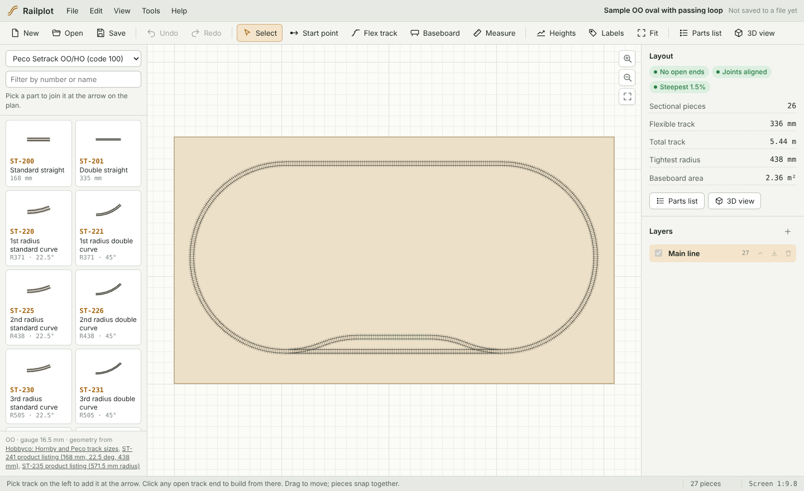
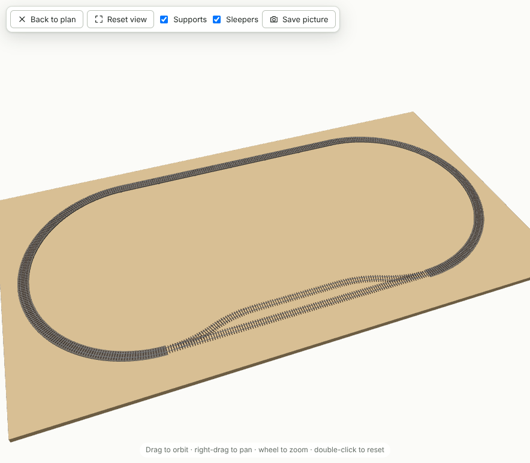

# Railplot

Railplot is a free, open-source track planner for OO and H0 model railways. You plan with real sectional track from the manufacturers' catalogues, add flexible track, set gradients and layers, check the layout in 3D and print a shopping list of parts.

It runs as a small Windows (and Linux) desktop app, or in any modern browser without installing anything.



## What it does

- **Real track libraries.** Peco Setrack (OO/HO code 100), Hornby OO sectional track (including the Y point, express points and power tracks) and PIKO A-Gleis H0 with and without roadbed (including Y, three-way, curved R2 and R3 points, crossings and the double slip), Peco Streamline code 100 points (small, medium and large radius), Märklin C-Gleis H0 (R1 to R5 and R9, standard and wide radius points, the double slip) and Kato Unitrack HO (R490 to R867, #6 points). Every library lists the sources for its geometry, and parts whose geometry is an estimate are marked ≈.
- **Baseboard modules.** The whole laser-cut baseboard range: 25 torsion-box modules in 4 mm birch ply, from 400 × 200 to 1200 × 900, 90° and 45° corners, a 60° curve, sliding traversers, turntables and canopy modules with a lighting pelmet. They join face to face and snap together, and each can have 1 to 4 tracks crossing its faces at centred positions that line up from module to module: click one to build from it, or lay flexible track along the guides in one go. The plan shows the frame under the top, the openings in the bottom skin, the dowel and bolt holes, the engraved guide lines, traverser decks and turntable discs; Railplot warns when a point motor would land on a frame member, and adds modules, joint hardware and slides or bearings to the parts list. See [Baseboard modules](docs/baseboard-modules.md).
- **Build by snapping.** Pick a part and it joins at the arrow on the plan. <kbd>Space</kbd> adds another, <kbd>F</kbd> turns a curve or point the other way, <kbd>Tab</kbd> joins a point by its next end. Ends that meet join automatically, and dragged pieces snap back into place.
- **Ready-made yards.** Fiddle yards with 2 to 8 roads (one end or both), a run-round loop and the Inglenook sidings shunting puzzle, built from the track system's own points and curves at a start point, open end or module track position. File > Example shunting layouts opens complete plans on the baseboard modules (an Inglenook shelf, a shunting plank with a traverser fiddle yard, and an L-shaped layout), worked out for your track system. See [Ready-made yards](docs/yards.md).
- **Flexible track.** Draw flex with the mouse or by numbers (straight length, radius and angle). Point at another open end and Railplot fits the smoothest join it can, refusing curves tighter than the track's minimum radius.
- **Heights and gradients.** Press <kbd>H</kbd>, click a joint and type a height. Gradients are shown on every sloping piece: green up to 2.5%, amber up to 4%, red above. Points and crossings stay level.
- **Plain baseboards.** Rectangles by size, or any shape by clicking corners.
- **Layers.** Show, hide, rename, reorder and move track between layers.
- **3D view.** Orbit around the layout with sleepers, rails and supports under raised track. Save a picture.
- **Parts list.** Counts of every part, with flexible track rounded up to whole lengths. Type what each part costs to get a total and the cost of each baseboard; prices are saved with the layout and offered again on your other layouts. Copy or save it as CSV.
- **Export.** PNG pictures, and SVG drawings at true scale (1 mm on paper = 1 mm on the layout) for printing templates.
- **Layout control.** Drive a real analogue layout from a laptop or any phone on your Wi-Fi: train speed and direction with momentum, points on servos, colour-light signals, lights and infrared train sensors, through a small ESP32 controller with DRV8876 track drivers. Start with one train on the whole layout. Split the track into blocks to run more, with power following each train and automatic signals keeping a free block between them. A simulator and a two-train demo let you try it without hardware. See [docs/control](docs/control/README.md) and [firmware](firmware/README.md).
- **Automation.** Routes set several points with one tap. Trips work out the way between two blocks from the plan, set the points and stop the train in the right block; shuttles and step-by-step automations run timetables and station stops. See [Automation](docs/control/automation.md).
- **The hub.** A single-file program for a laptop or Raspberry Pi that runs the layout with no screen needed: several phones drive at once, automations keep going, and Engine Driver and WiThrottle apps can drive the analogue trains. See [the hub](docs/control/hub.md) and [throttle apps](docs/control/throttles.md).
- **DCC-EX.** An EX-CommandStation's track outputs can be Railplot's analogue blocks, over USB or the network. See [DCC-EX](docs/control/dcc-ex.md).
- **Plan with Claude.** The Railplot connector lets Claude (in the Claude desktop app or Claude Code) read your plans, check them and propose changes: modules, yards, track, example layouts. Each proposal appears under Claude's proposals, where you see it on the plan and accept or reject it; nothing changes until you do. With the hub, and only if you allow it, Claude can also set routes and points and run trains, never track power. See [Claude and Railplot](docs/claude.md).
- **Safe by default.** Unlimited undo, and your current plan is kept automatically between sessions.



## Download

Download the latest Windows installer (`Railplot_x.y.z_x64-setup.exe`) or Linux package from the [Releases](../../releases) page.

Prefer not to install? Download `railplot-offline.html` from the same page and open it in Edge, Chrome or Firefox. It works offline and saves layouts as files.

The [Railplot hub](docs/control/hub.md) for Windows, Linux, Raspberry Pi and Mac is on the same page, with the [Claude connector](docs/claude.md) bundles (`railplot-claude-*.mcpb`) for the Claude desktop app.

The guides are also published as a website with the browser version of Railplot (GitHub Pages, built by `.github/workflows/pages.yml`).

## Using Railplot

1. **Start.** File > New layout gives you a baseboard of the size you choose. Press <kbd>S</kbd> and click to put down a start point. Drag while clicking to aim it.
2. **Lay track.** Choose a library at the top left, then click parts. Each one joins at the arrow. Click any open track end (the short orange ticks) to build from there instead.
3. **Close gaps.** Press <kbd>G</kbd> for flexible track, click one open end and point at the other.
4. **Add grades.** Press <kbd>H</kbd>, click a joint circle, then use <kbd>↑</kbd> <kbd>↓</kbd> or type the height in millimetres.
5. **Check it.** The Layout panel on the right shows open ends, misaligned joints, the steepest gradient and the tightest radius. Press <kbd>3</kbd> for 3D.
6. **Shop.** Open the Parts list.

Help > Keyboard shortcuts lists every shortcut.

## Building from source

You need [Bun](https://bun.sh) 1.1 or newer. For the desktop app you also need [Rust](https://rustup.rs) and the [Tauri prerequisites](https://tauri.app/start/prerequisites/) for your system (on Windows: the Microsoft C++ Build Tools and WebView2, which Windows 11 already has).

```sh
bun install                # TypeScript and the Tauri CLI (the app itself has no runtime dependencies)
bun run build              # dist/index.html: the whole app in one file
bun test tests             # unit tests for geometry, joining, heights, files
bun run validate-libraries # checks every track library
bunx tauri dev             # run the desktop app
bunx tauri build           # build installers into src-tauri/target/release/bundle
bun run hub                # run the Railplot hub from source
bun run mcp                # run the Claude connector from source (stdio)
bun scripts/build-hub.ts   # the hub as a single-file program (--all for every platform and the .mcpb bundles)
bun run docs               # the guides as a website, in site/
```

End-to-end tests drive the built app in Chromium through every core flow, and run the hub with two browsers and a scripted throttle app:

```sh
pip install playwright && python -m playwright install chromium
python tests/e2e/test_flows.py
python tests/e2e/test_hub.py
```

### Project layout

| Path | What's in it |
| --- | --- |
| `src/geom.ts` | Plane geometry: poses, straights and arcs, tangent arcs, biarcs, triangulation |
| `src/library.ts`, `src/libraries/*.json` | The track library format and the built-in libraries |
| `src/model.ts` | The layout document and every editing operation (pure functions, no UI) |
| `src/render2d.ts`, `src/view3d.ts` | The 2D plan renderer and a small WebGL 2 3D viewer |
| `src/app.ts`, `src/ui/` | The editor: tools, panels, menus, dialogs |
| `src/platform.ts` | File access through Tauri on the desktop or the browser otherwise |
| `src/control/` | Layout control: the engine (blocks, trains, signals, automations), trip planning, controller links (ESP32, DCC-EX, simulator), the hub client and the Control panel |
| `src/hub/` | The Railplot hub: web and WebSocket server, WiThrottle server, mDNS, DCC-EX over TCP and serial |
| `src/mcp/`, `src/proposals.ts` | The Claude connector (an MCP server over stdio: tools, plan operations, file and hub access) and proposals |
| `scripts/` | Builds: the app, the hub programs, the docs website |
| `firmware/` | ESP32 controller firmware (Arduino/PlatformIO) |
| `src-tauri/` | The Tauri desktop shell (file dialogs and file access only) |
| `tests/` | Unit tests (`bun test`) and end-to-end tests (Playwright) |

## Adding a baseboard module

Module presets in `src/boards/` are generated from the baseboard range's design data (`data/baseboard-range.json`) by `bun scripts/import-baseboards.ts`. [docs/baseboard-modules.md](docs/baseboard-modules.md) describes the fields and how to update them.

## Adding a track system

Track libraries are plain JSON files in `src/libraries/`. [docs/library-format.md](docs/library-format.md) explains the format with examples. Please include a source for every dimension (a manufacturer's catalogue, product page or planning sheet) and run `bun run validate-libraries` before opening a pull request.

## Roadmap

Next up, roughly in order:

- More libraries: Hornby curved points and diamond crossings, Roco geoLine, Bachmann E-Z Track, Tillig, more Märklin C and Kato Unitrack points
- Exact Hornby express point geometry (currently an estimate)
- Transition curves, helix and parallel-track tools
- Scenery: platforms, buildings, roads and signals with original artwork
- Tunnels and bridges, terrain in 3D
- Tiled 1:1 printing and DXF export
- Synchronised PWM across controllers, reversing loops, solenoid point motors

## File format

Layouts are saved as `.railplot` files, which are readable JSON. See [docs/file-format.md](docs/file-format.md).

## Licence

Railplot is released under the [MIT licence](LICENSE).

Railplot is an independent project and is not affiliated with Peco, Hornby, PIKO or any other manufacturer, nor with any other track-planning software. Product names and catalogue numbers are used only to identify compatible track and belong to their owners.
