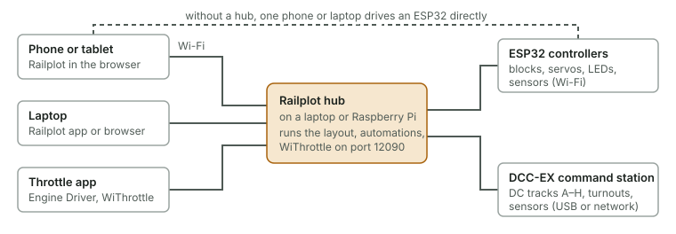
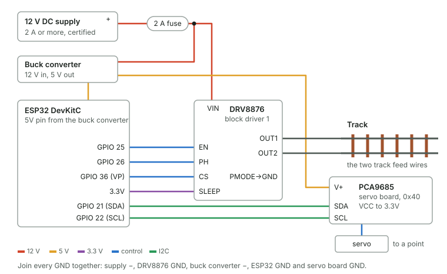
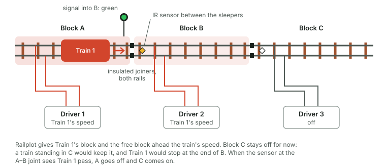

# Controlling the layout from a laptop or phone

Railplot can run a real analogue (DC) layout: train speed and direction, points, colour-light signals, lights, and infrared sensors that show where trains are. You drive from Railplot on a laptop, or from any phone browser on the same Wi-Fi, with no internet needed.

The plan you drew is the control panel. You tap a point on the plan to throw it, tap a signal to hold it at red, and drive each train with its own slider. Routes set several points with one tap, and automations drive trains for you (see [Automation](automation.md)).

Railplot does the thinking: which block gets which train's power, when a signal turns red, which block a train has moved into. The controller does what Railplot tells it ten times a second. If it stops hearing from Railplot for 1.5 seconds, it cuts track power, so a dropped phone or a flat battery stops the trains.

You can run everything from one phone or laptop. For more, run the [Railplot hub](hub.md) on a laptop or Raspberry Pi: several phones drive different trains at once, [WiThrottle and Engine Driver apps](throttles.md) work, and automations keep going with every screen closed. If you already have a [DCC-EX command station](dcc-ex.md), Railplot can use its outputs as analogue blocks.

None of this has been tested on a real layout yet. [Hardware testing](testing.md) says what has been checked and how you can help.

You can try all of this without hardware: in Railplot press **Control**, then **Try it with the simulator** or **Open the two-train demo**.

**Drive in 3D** (Control > Drive, View > Drive in 3D, or <kbd>D</kbd>) shows the simulated trains on your layout in 3D. Pick a train at the bottom (or <kbd>1</kbd>–<kbd>9</kbd>), drive with the slider or <kbd>Q</kbd> and <kbd>E</kbd> (<kbd>Shift</kbd> for bigger steps), stop it with <kbd>Space</kbd> (<kbd>Shift</kbd>+<kbd>Space</kbd> stops all), change the camera with <kbd>C</kbd> (behind the train, from the cab, or the whole layout) and switch km/h and mph with <kbd>U</kbd>. <kbd>Esc</kbd> goes back to the plan. The simulated trains follow the real track through the points as they're set, trip the sensors they pass over and draw current in the blocks they stand in, so everything in Control works on them as on a real layout. A train stopped across a block joint is in both blocks, as it would be for real.

---

## Phase 1: one train, points and lights

Start with the whole layout as one block. Railplot replaces your analogue controller's knob, and you can add servos for points and LEDs for lights straight away.

### Parts

[shopping-list.xlsx](shopping-list.xlsx) has every part with where to buy it, prices and a calculator: change the number of blocks, points, sensors and signals and the quantities and total follow. On 21 October 2026, phase 1 came to about €50 and a full ten-train setup to about €235.

| Part | How many | Notes |
| --- | --- | --- |
| ESP32 development board (ESP32-WROOM-32, "DevKitC" type) | 1 | The controller. |
| Pololu DRV8876 motor driver carrier (#4036) | 1 per block | 4.5–37 V, 1.3 A continuous, current sensing. One drives the whole layout in phase 1. A cheaper DRV8871 module works too; see "Budget block drivers" below. |
| 12 V DC power supply, 2 A or more | 1 | A certified plug-in supply. OO and H0 analogue track runs at up to 12 V DC. |
| Fuse holder and 2 A fuse | 1 | In the 12 V line, close to the power supply. |
| 12 V to 5 V buck converter, 3 A | 1 | Powers the ESP32 and the servos. |
| PCA9685 16-channel servo board | 1 per 16 points | Leave its address at 0x40. |
| Micro servos (MG90S metal gear, or SG90) | 1 per point | With 0.8 mm piano wire to reach the point's tie bar. |
| PCA9685 board for LEDs | 1 per 16 LEDs | Bridge solder jumper A2 so it answers at 0x44. Only needed for signals or lights. |
| Wire | | 0.5 mm² for track feeds and power, jumper wires for the logic connections. |

### Wiring

1. **Take your old controller off the track.** Never connect it and the Railplot driver to the same rails.
2. **Power.** 12 V supply → fuse → DRV8876 **VIN** and the buck converter input. Buck converter 5 V out → ESP32 **5V** pin and the servo board's **V+** terminal. Join every **GND** together: power supply, driver, buck converter, ESP32 and all boards.
3. **Track driver** (block driver 1):

   | DRV8876 pin | Connect to |
   | --- | --- |
   | VIN, GND | 12 V and ground |
   | OUT1, OUT2 | The two track feed wires (where your old controller's wires went) |
   | EN | ESP32 GPIO 25 |
   | PH | ESP32 GPIO 26 |
   | CS | ESP32 GPIO 36 (VP) |
   | SLEEP | ESP32 3.3V |
   | PMODE | GND (selects PH/EN control) |

   With SLEEP on 3.3 V the driver limits current to about 1.3 A, which suits OO and H0 locos.
4. **Servo board.** VCC → ESP32 3.3V, GND → GND, SDA → GPIO 21, SCL → GPIO 22, V+ → 5 V from the buck converter. Plug the servos in; Railplot's **Wiring list** says which point goes on which pin.
5. **LED board** (optional), on the same four I2C wires. Each LED goes from an output pin through a 1 kΩ resistor to the LED's anode, with its cathode to GND. Colour-light signals need to be the common-cathode type.

The other five block drivers use these pins, for phase 2:

| Driver | EN | PH | CS |
| --- | --- | --- | --- |
| 1 | 25 | 26 | 36 |
| 2 | 27 | 14 | 39 |
| 3 | 13 | 4 | 34 |
| 4 | 16 | 17 | 35 |
| 5 | 18 | 19 | 32 |
| 6 | 23 | 5 | 33 |

### Put the firmware on the ESP32

The firmware is in [`firmware/`](../../firmware). First edit `firmware/railplot-controller/config.h`:

- To use your home Wi-Fi, set `WIFI_SSID` and `WIFI_PASSWORD`.
- Or leave them empty, and the controller makes its own network called **Railplot** (password `railplot-trains`, change it). Phones then join that network and open http://192.168.4.1.

Then upload it, either way:

- **PlatformIO** (VS Code): open the `firmware` folder, then run `pio run -t upload` and `pio run -t uploadfs`. The second command puts Railplot itself on the controller.
- **Arduino IDE 2**: install the "esp32 by Espressif" boards package, open `firmware/railplot-controller/railplot-controller.ino`, choose the "ESP32 Dev Module" board and upload. Then put Railplot onto the controller from Railplot itself (see below).

The LED on GPIO 2 (built into many ESP32 boards) blinks while nobody is driving and stays lit while you are.

### Set up in Railplot

1. Open your plan and press **Control** (or the C key).
2. Press **Set up with a controller**. This makes one block called **Whole layout** on driver 1, one train, and a servo number for every point.
3. In **Set up**, check the controller's address: `railplot.local`, or its IP address such as `192.168.4.1`.
4. Press **Install Railplot on the controller**. Phones on the same Wi-Fi can now open **http://railplot.local** (or the IP address) and drive. Press **Send layout to controller** again whenever you change the plan.
5. Open **Wiring list** to see what goes on which pin.
6. On the **Drive** tab, nudge the slider. Raise **Starts moving at** in Set up until the loco just creeps at the bottom of the slider, then set **Top speed** to a scale speed you like.

Only one device drives at a time. If a second phone opens the layout, it shows **Another device is driving** with a **Take over** button.

On a laptop, the desktop app and the offline file (`railplot-offline.html`) can both talk to the controller. The hosted web version can't, because browsers block https pages from reaching devices on your home network.

### Points: servos

Servos are the recommended point motors. They're cheap, they move slowly like the real thing, and one servo board runs 16 of them (64 per controller).

- Drill a 5 mm hole through the baseboard under the point's tie bar. Mount the servo underneath, and run piano wire from the servo arm up through the tie bar.
- An omega loop bent in the wire lets the servo push slightly past the blades' travel without straining them.
- In **Set up > Points**, press **Straight** and **Turn** and adjust the pulse values (around 1300–1700 µs) until the blades just close each way.
- The controller moves servos slowly and switches their pulse off once they arrive, so they don't buzz. Setrack, Hornby and PIKO A points have their own over-centre springs to hold the blades.
- **On the laser-cut baseboard modules**, put servos in the openings in the bottom skin. Railplot flags any point whose motor would sit over a cross member or the spine.
- Peco Setrack, Hornby and PIKO A-Gleis points have plastic (insulated) frogs, so no frog switching is needed. Electrofrog points need a microswitch on the servo to switch frog polarity.

Solenoid motors (Peco PL-10, Hornby R8243) need a capacitor discharge unit and pulsed outputs. This firmware doesn't drive them yet.

---

## Phase 2: blocks, sensors and signals, for more trains

With analogue DC, each train needs its own section of track. Railplot uses **computer cab control**: every block has its own driver, and Railplot gives each block the speed of the train that's in it. As a train moves into the next block, its power goes with it.

### How it works

- **Blocks.** Cut both rails at each end of every block with insulated joiners: Peco SL-11 (code 100), Hornby R920, PIKO 55291. Feed each block from its own DRV8876. Every block is fed the same way round (OUT1 to the same rail all round the layout), so forward means the same direction everywhere. Reversing loops aren't supported yet.
- **One free block between trains.** A moving train gets its own block plus the free blocks it could run into. A block that two moving trains could both enter goes to the one that had it first; if neither had it, it stays dead and the trains stop either side of it. A train standing still with its throttle at zero only keeps its own block. Plan at least two blocks per train: about 20 blocks for 10 trains.
- **Sensors.** An infrared reflective sensor module (TCRT5000 type) between the sleepers just past each block joint tells Railplot that a train has moved on. **Add sensors at block joints** in Set up places one at every joint. Wire each module's **OUT** to an MCP23017 input, and its VCC and GND to 3.3 V and ground. Each MCP23017 board takes 16 sensors; set its address jumpers to 0x20, 0x21 and so on.
- **Signals.** Each signal guards the way into a block. In automatic mode it shows green when the block ahead is free, yellow when the block after that isn't, and red when a train is in the block ahead or the points are set against it. Tap a signal to hold it at red; trains then stop at it.
- **Points under trains.** Railplot won't throw a point while a moving train is in that point's block.
- **Shorts.** Each driver reports its current. Over 1.25 A, Railplot cuts that block, stops its train, and shows a **Fault** with a **Reset** button.

### The wiring plan

Once the track is split into blocks, **Set up** shows the wiring on the plan:

- **Black ticks across the rails** mark every block joint. Cut both rails there with insulated joiners (on Märklin C, the centre rail only).
- **Amber ticks** mark where the roads leave an **Electrofrog** point: insulated joiners on its two frog rails, and a frog feed through a changeover switch on the point's motor or servo, so the frog takes the polarity of the road it's set for.
- **F** marks the track feeds, in the block's colour. Each block gets one on its longest plain piece, and more until no piece is further than 1.5 m from a feed, so the joiners don't have to carry the current.

**Wiring diagram** draws each ESP32 controller with its power, its block drivers and the pins they use, the blocks they feed, and the sensor and servo boards on the I2C bus. Save it as SVG to print. The **Parts list** adds what the wiring needs: joiner packs, feed pairs, frog feeds, about how much bus wire, and the boards, drivers, sensors and servos.

### Detecting trains by current

The infrared sensors see a train cross a block joint. As a second check, turn on **Detect trains by the current they draw** in Set up (DRV8876 drivers and firmware 0.4 or later). Each driver measures its block's current. In a powered block a moving loco shows by itself. Into blocks with no power, the controller sends a full-voltage pulse of 0.6 ms ten times a second, too short to move anything, and measures what flows.

- **Locos always show.** For wagons and coaches, fit a resistor wheelset to one axle of each: a 2.2 kΩ surface-mount resistor (0805 size) glued across the insulated wheel and the axle and painted with conductive paint, or ready-made resistor wheelsets. It draws about 5 mA in a pulse. The default threshold, 3 mA, sees it.
- **Something where no train is booked** (a wagon left behind, a train put down by hand): Railplot warns, draws the block in dashed red, and won't send a train into it until it reads clear or you place a train there.
- **A missed sensor:** when a train's block goes quiet and the one block it was heading into lights up, Railplot moves the train on anyway.
- **The tail of a train** keeps a block lit for a moment after the train moves on. Railplot waits 10 seconds before calling a block a train has just left occupied.

The simulator draws current too, and **Leave a wagon in** lets you try it without a layout.

### Budget block drivers

DRV8871 modules cost a fraction of the DRV8876 carrier and are fine for OO and H0. Set `DRIVER_TYPE` to `DRIVER_DRV8871` in `config.h`, then wire each module's **IN1** where the table says EN, and **IN2** where it says PH. Leave CS unconnected.

These modules have no current output, so Railplot can't spot a short circuit or a stalled train in a block. The module still protects itself: its current limit is set by the resistor on the board, usually about 2 A. DRV8871 needs at least 6.5 V, so the 12 V supply is fine.

### More than six blocks

One controller has six block drivers. For more blocks, add another controller, with its own `HOSTNAME` (for example `railplot-2`), on the same Wi-Fi. Add it in **Set up > Controllers** and give its blocks drivers on it.

Try to keep **neighbouring blocks on the same controller**. A controller drives all six blocks from one timer, so a loco bridging the gap between two of them sees exactly the same pulses on both sides. Two controllers' pulses aren't in step. Where their blocks meet, a loco crossing the joint briefly connects two drivers that disagree. The drivers' current limit protects them, but you may see a spark at the joint and a slow loco may stutter there. Keep those joints few, and put them where trains run at speed. Synchronising controllers over one extra wire is planned for a later firmware.

If your aim is mostly lots of trains, DCC needs far less wiring. Railplot can also drive a [DCC-EX command station](dcc-ex.md), whose outputs can each be an analogue block.

### Expansion limits per controller

| What | Per controller |
| --- | --- |
| Blocks (track drivers) | 6 |
| Point servos | 64 (4 servo boards, 0x40–0x43) |
| LED outputs for signals and lights | 64 (4 LED boards, 0x44–0x47) |
| Train sensors | 128 (8 sensor boards, 0x20–0x27) |

Keep I2C wiring short, about a metre in total. For a layout across several baseboards, a controller per board pair is tidier than long I2C cables.

---

## Safety

- Use a certified, plug-in 12 V DC power supply. Don't wire anything at mains voltage.
- Fit the 2 A fuse in the 12 V line.
- Unplug the power before changing any wiring.
- Never connect an old analogue controller to rails a Railplot driver is feeding.
- The **Stop all trains** button and the Space key cut every train at once, and the controller cuts power by itself if it loses contact with Railplot.

---

## Going further

- [Automation](automation.md): routes, trips, shuttles and timetables.
- [The Railplot hub](hub.md): run the layout from a laptop or Raspberry Pi, with as many phones as you like.
- [Throttle apps](throttles.md): Engine Driver and WiThrottle.
- [DCC-EX](dcc-ex.md): use a DCC-EX command station's outputs as blocks.
- [Firmware](../../firmware/README.md): the controller's settings and its HTTP interface.
